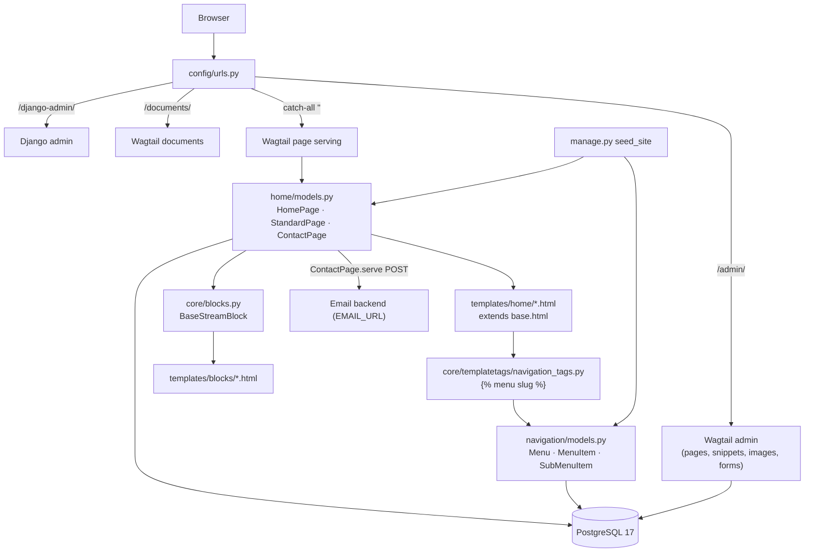

# System Architecture

## High-Level Overview

A conventional **Django + Wagtail monolith** (server-rendered HTML). Wagtail owns the page tree,
admin UI, revisions, images, documents, search (database backend) and form submissions. Project
code is split into three small Django apps plus a settings package:

- `config/` — settings (`base` / `dev` / `prod`), URL routing, WSGI/ASGI.
- `home/` — page models (`HomePage`, `StandardPage`, `ContactPage`) and the `seed_site` command.
- `navigation/` — menu data model (`Menu` snippet → `MenuItem` → `SubMenuItem`).
- `core/` — cross-cutting presentation pieces: StreamField blocks and the `` template tag.

## Subsystems & Layers

### 1. Presentation Layer
- **Location**: `templates/`, `static/`, `core/templatetags/navigation_tags.py`, block `Meta.template`s.
- **Responsibilities**: `templates/base.html` renders `<title>`/meta description from
  `seo_title`/`search_description`, the header with `` and a mobile toggle,
  and the footer with ``.
  `static/js/nav.js` handles the hamburger toggle, dropdown toggles (`aria-expanded`) and
  Escape-to-close. `static/css/site.css` is the only stylesheet.

### 2. Domain / Content Model Layer
- **Location**: `home/models.py`, `navigation/models.py`, `core/blocks.py`.
- **Responsibilities**: page-type tree rules (`parent_page_types`, `subpage_types`, `max_count`),
  admin panels, search fields, and validation invariants (page-or-URL exactly-one rules in
  `HomePage.clean`, `LinkFields.clean`, `CallToActionBlock.clean`).

### 3. Data / Infrastructure Layer
- **Location**: `config/settings/*.py`, `docker-compose.yml`, `Dockerfile`, migrations.
- **Responsibilities**: PostgreSQL via `DATABASE_URL` (`CONN_MAX_AGE=60`, health checks),
  email via `EMAIL_URL` (console by default), file storage for media, WhiteNoise compressed
  manifest storage in prod, HTTPS/HSTS/secure-cookie hardening in `prod.py`.

## Data Flow & Lifecycle

### Page request (`GET /about/`)
1. `config/urls.py` routes everything not matched by `admin/`, `django-admin/`, `documents/`
   (and static/media in DEBUG) to `wagtail.urls`.
2. Wagtail resolves the path against the `Site` root (the `HomePage`) and calls
   `page.serve()`, which renders `templates/home/<model>_page.html` with `page` in context.
3. The template renders `page.body` (StreamField); each block renders via its
   `templates/blocks/*.html`.
4. `base.html` calls `` → `menu()` → `get_menu_links(slug, current_page, request)`:
   loads the `Menu` with `prefetch_related` on items/sub-items/pages, filters out items whose
   page is not `live` or not `show_in_menus` (`LinkFields.is_visible`), builds `NavLink`
   dataclasses and computes active state.
5. Active state (`_build_link`): exact page → `is_current` (`aria-current="page"`); page path is
   a prefix of the current page's path and depth > 2 → `is_ancestor` (`aria-current="true"`);
   a parent whose child is active is also marked ancestor. Site roots (depth ≤ 2) only match
   exactly, so "Home" is not active everywhere.

### Contact form (`POST /contact/`)
1. `ContactPage` (`AbstractEmailForm`) builds a form from its `FormField` rows.
2. Valid → `FormSubmission` stored, email sent to `to_address` with `subject`, landing template
   `contact_page_landing.html` shows `thank_you_text`.
3. Invalid → page re-rendered with errors (`role="alert"`), nothing stored or sent.

### Seeding (`make seed` / `seed_site [--force]`)
Runs in one transaction: aborts if a `HomePage` exists (unless `--force`, which re-points
`Site` roots and deletes the old tree and all menus), deletes Wagtail's default welcome page,
creates and publishes Home → About, Services (→ Web Design, Consulting), Contact (with
Name/Email/Message fields), points the default `Site` at Home, and creates the `main` (with
Services dropdown) and `footer` menus.

### Deployment
`Dockerfile` builds a uv venv in `/opt/venv` and defaults to gunicorn with
`config.settings.prod`. `docker-compose.yml` overrides the command for dev
(`migrate` + `runserver`, source bind-mounted) and runs `postgres:17` with a healthcheck.
TLS is expected to terminate at a reverse proxy that sets `X-Forwarded-Proto`.
