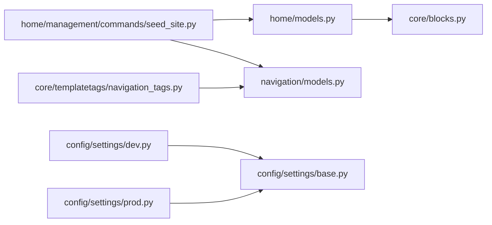

# Dependencies & Ecosystem

## Internal Dependency Graph

- **Root Entrypoints**:
  - `manage.py`, `config/wsgi.py`, `config/asgi.py` (Django bootstraps)
  - `home/management/commands/seed_site.py` (out-degree 2)
  - `core/templatetags/navigation_tags.py` (loaded by templates; out-degree 1)
  - `config/settings/dev.py`, `config/settings/prod.py` (out-degree 1 each)
- **Core Hub Modules** (most imported internally):
  - `navigation/models.py` (imported by 5 files)
  - `home/models.py` (2)
  - `core/blocks.py` (2)
  - `config/settings/base.py` (2)
- Templates reference code indirectly: block `Meta.template` → `templates/blocks/*`,
  page models → `templates/home/<model_snake>.html`, `` → `templates/navigation/*`.

## Third-Party Libraries

Runtime (`[project.dependencies]` in `pyproject.toml`, locked in `uv.lock`):

| Package | Version | Purpose | Key Usage Files |
| :--- | :--- | :--- | :--- |
| `wagtail` | `>=7.4,<7.5` (LTS) | CMS: pages, admin, snippets, forms, images, docs, search | `home/models.py`, `navigation/models.py`, `core/blocks.py`, `config/urls.py` |
| `django` | `>=5.2,<5.3` (LTS) | Web framework | everywhere |
| `django-modelcluster` | via Wagtail | `ParentalKey`, `ClusterableModel` for nested inlines | `navigation/models.py`, `home/models.py` |
| `django-taggit`, `django-filter` | via Wagtail | Installed apps required by Wagtail | `config/settings/base.py` |
| `django-environ` | `>=0.12` | Env-var config (`env.db`, `env.email`) | `config/settings/base.py` |
| `psycopg[binary]` | `>=3.2` | PostgreSQL driver | `DATABASE_URL` |
| `whitenoise` | `>=6.8` | Static files in prod | `config/settings/prod.py` |
| `gunicorn` | `>=23` | WSGI server in Docker image | `Dockerfile` |

Dev (`[dependency-groups] dev`):

| Package | Version | Purpose |
| :--- | :--- | :--- |
| `pytest` | `>=9.2.0` | Test runner |
| `pytest-django` | `>=4.14.0` | Django integration (`--reuse-db`) |
| `pytest-cov` | `>=7.1.0` | Coverage (`make cov`) |
| `ruff` | `>=0.17.6` | Lint + format |

## External Services & Network Dependencies
- **PostgreSQL 17** — `postgres:17` container (`docker-compose.yml`), connected via `DATABASE_URL`. Required for tests.
- **SMTP / email** — `EMAIL_URL` (default `consolemail://`, prints to stdout). Used by `ContactPage`.
- **Reverse proxy (prod)** — terminates TLS, must send `X-Forwarded-Proto`.
- **Docker images** — `python:3.12-slim-bookworm`, `ghcr.io/astral-sh/uv:0.8`.
- **Tooling** — `uv` (deps/venv), Docker Compose, GNU/BSD `make`.
